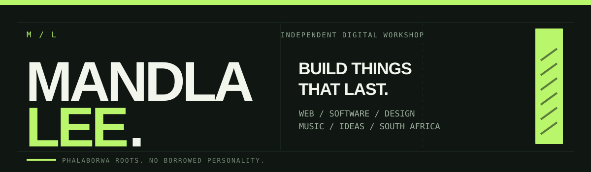

  

# I don't fit in one box.

**Mandla Lee Ndlovu** · builder, creative, independent thinker  
**South Africa** · making things for the internet and for life outside it

*I make music. I build software. I start businesses. I turn random ideas into real experiments. Sometimes all in the same week.*

[**Explore my work**](https://mandlalee.github.io/LeeR500/) · [**Phala Digital**](https://github.com/MandlaLee/LeeR500) · [**All repositories**](https://github.com/MandlaLee?tab=repositories) · [**Get in touch**](mailto:mandlaleendlovu@outlook.com)

---

## THE PERSON BEHIND THE PROJECTS

A typical introduction would call me a web developer. That's true, but it's not the whole story.

I'm interested in how **technology, creativity, business and culture** can come together to solve problems and tell stories. I'll spend a day working on a client website, then go down a rabbit hole figuring out how to automate something, design a better interface, build an app for my own computer or develop an idea for a game.

I don't believe curiosity needs to stay inside one job title.

**The builder.** I like taking something from “what if?” to a thing you can actually open, try and improve.

**The artist.** Under the name **Mandla Lee**, I make music and write stories. Music and South African creative culture are as much a part of my identity as computers.

**The entrepreneur.** I'm building **Phala Digital** around useful digital work for real businesses, while exploring creative software products of my own.

**The experimenter.** I use AI, open source and whatever I can learn to push ideas further. Not everything works on the first attempt. I'd rather find out by building.

> **My rule:** Don't confuse a working demo with a finished product. Build, test, improve—and keep the parts that actually work.

---

## SELECTED PROJECTS / THINGS YOU CAN EXPLORE

These are real public repositories. Some are tools, some are working foundations, and some are experiments. I try to be clear about the difference.

### 01 — Tools that make digital work easier

| Project | What it is |
| :-- | :-- |
| **[WebPfyer](https://github.com/MandlaLee/WebPfyer)** | An image-conversion and web-asset optimisation tool that runs in the browser. |
| **[SiteFyer](https://github.com/MandlaLee/SiteFyer)** | A website-mirroring experiment with public-page discovery, checkpoints and ZIP export. |
| **[ClipFyre](https://github.com/MandlaLee/clipfyre)** | An experimental pipeline for finding short clips in longer videos. |
| **[Mandla Brain](https://github.com/MandlaLee/mandla-brain)** | My system for keeping decisions, design standards and project context consistent across AI tools. |

### 02 — Businesses, people and communities

| Project | What it is |
| :-- | :-- |
| **[Phala Digital](https://github.com/MandlaLee/LeeR500)** | My web-development identity and a portfolio of digital work for businesses and brands. |
| **[Kingship Christian Centre](https://github.com/MandlaLee/thethrivegeneration)** | Website and digital content work for a faith community. |
| **[123Kasi](https://github.com/MandlaLee/123Kasi)** | A South African media-feed prototype built around organising and discovering photos and videos. |

### 03 — Games, creative ideas and open source

| Project | What it is |
| :-- | :-- |
| **[Township Shop Tycoon](https://github.com/MandlaLee/Township-Shop-Tycoon)** | A South African-inspired shop-management game experiment. |
| **[Cutawan — Intel macOS support](https://github.com/MandlaLee/cutawan)** | My fork of [JeremySNR's open-source AI video clipper](https://github.com/JeremySNR/cutawan), with an x64 packaging workflow tested on Intel Mac hardware. |

**A note on Cutawan:** the Intel application has been built and launched on macOS Monterey. Full AI clipping and long-video performance testing on that machine is separate work; the original Cutawan project belongs to its upstream contributors.

---

## WHAT I'M EXPLORING NEXT

My ideas aren't limited to the public repositories above. I'm also exploring:

- **Desktop software and AI assistants** — practical tools for automation, media workflows and personal productivity.
- **Digital products** — turning useful one-off tools into software that others can use.
- **Games with a South African point of view** — everyday settings, local businesses and stories as spaces worth playing in.
- **Music and creator culture** — writing, releasing music and creating more room for local artists to be seen and heard.
- **Better design systems** — interfaces that feel intentional, not like another generic AI-generated dashboard.

Some of these are experiments or private work in progress. I don't label unfinished work as launched products.

---

## MY TOOLBOX

`JavaScript` · `TypeScript` · `Python` · `Swift` · `HTML` · `CSS`

`React` · `Electron` · `GitHub Actions` · `FFmpeg` · `Git` · `AI-assisted development`

My favourite tool is usually whichever helps me **understand the problem, reuse good work, and ship something reliable**. I don't care about writing every line from scratch for the sake of it.

---

## OUTSIDE THE CODE

I'm a South African creative with roots in Limpopo. My interests stretch from music production and songwriting to branding, storytelling, business ideas and the communities behind them.

That range isn't a distraction from my work. **It's where a lot of my ideas come from.**

---

### Have an idea worth building?

I collaborate on websites, useful tools, creative projects and interesting open-source work.

[**View my work**](https://mandlalee.github.io/LeeR500/) · [**Email me**](mailto:mandlaleendlovu@outlook.com)

Code is one of the ways I make things. It isn't the only one.

